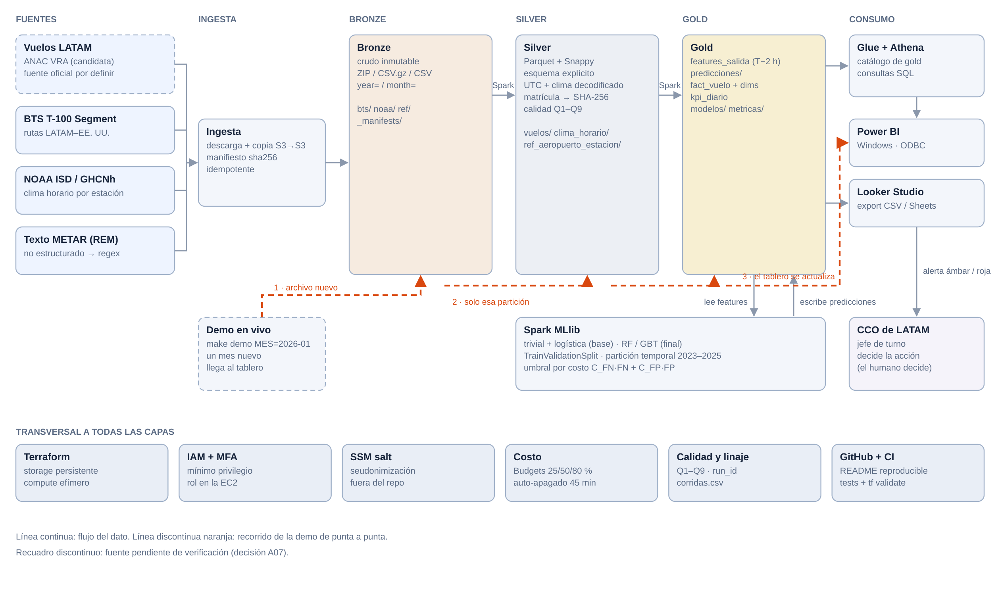
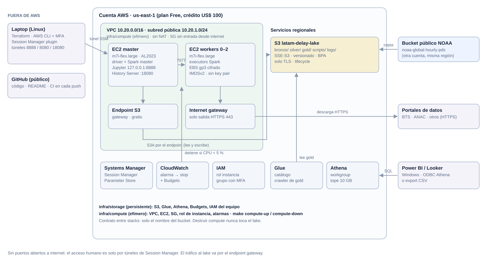

# LATAM Ops: alerta temprana de demoras de salida

Proyecto del curso Big Data y Analítica de Datos (UPAO, 2026-20).
Autor: Carlos Alonso Díaz Uceda. Despliegue: nube (AWS, us-east-1).

Dos horas antes de cada salida programada de LATAM Airlines en su red de Brasil, el sistema estima la
probabilidad de que el vuelo salga con 15 minutos o más de demora (alerta ámbar) o con 60 minutos o más (alerta
roja). La lista de vuelos en alerta va al Centro de Control de Operaciones (CCO), donde el jefe de turno decide qué
hacer: avión o tripulación de reserva, re-protección de conexiones o aviso a los pasajeros.

## Por qué importa para LATAM

| Referencia | Valor | Fuente |
|---|---|---|
| Puntualidad de llegada de LATAM en 2025 (todo el grupo) | 82,40 % | Cirium, On-Time Performance Review 2025 |
| Puntualidad de llegada de LATAM pasajeros en Brasil (2025) | 82,17 % | ANAC VRA, medido en este proyecto |
| Salidas de LATAM pasajeros en Brasil con 15 min o más (2025) | 18,96 % de 298 585 vuelos operados | ANAC VRA, medido en este proyecto |
| Costo directo de un minuto de demora en tierra | US$ 69,07 (A4A 2025 sin combustible); US$ 28,90 (Brasil, 2010 actualizado) | Airlines for America; Bendinelli et al., SITRAER 2015 |

Resultados en el test (todo 2025). El modelo se entrenó en el clúster de AWS con todo el periodo de entrenamiento
(2023-01 a 2024-06) y los hiperparámetros se eligieron en validación (2024-07 a 2024-12):

| Modelo | AUC-ROC | AUC-PR |
|---|---|---|
| Referencia: tasa histórica por aeropuerto y hora (≥ 15 min) | 0,653 | 0,288 |
| Regresión logística (≥ 15 min) | 0,709 | 0,376 |
| Random Forest, 100 árboles, profundidad 10 (≥ 15 min) | 0,716 | 0,393 |
| Referencia (≥ 60 min) | 0,615 | 0,038 |
| Random Forest, 100 árboles, profundidad 10 (≥ 60 min) | 0,694 | 0,088 |

El valor se mide contra la referencia y no contra "no hacer nada": con el mismo número de vuelos revisados por
aeropuerto, ¿cuánto más deja el modelo que una tabla de tasas por aeropuerto y hora? Solo empresas de pasajeros,
test 2025, escenario base (cada acción ahorra hasta 10 min, US$ 69,07 por minuto, US$ 150 por acción), intervalos
de confianza del 95 % por bootstrap de días:

| Lista | Alertas por día | Precisión modelo / tabla | Beneficio neto | Atribuible al modelo | Se paga si cada acción ahorra |
|---|---|---|---|---|---|
| Ámbar, máximo 10 por aeropuerto y día | 145 | 27,7 % / 23,6 % | US$ 8,4 M | US$ 1,97 M (1,64–2,27) | 4,3 min |
| Roja (60 min o más) | 5,5 | 25,0 % / 6,0 % | US$ 0,8 M | US$ 0,30 M (0,03–0,63) | 2,5 min |

En el escenario pesimista (5 min por acción, US$ 28,90 por minuto, US$ 300 por acción) ninguna lista se paga. La
alerta roja detecta pocas demoras de 60 min o más en vuelos de pasajeros: 6,6 % en 2025 y 5,0 % en enero de 2026
(cuando el modelo incluía a LATAM Cargo parecía detectar 24,8 %, pero casi todos esos aciertos eran cargueros); sirve
como lista corta de alta precisión, no como red de seguridad. En
SBGR y SBSP la alerta ámbar empata con la tabla: ahí manda la rotación del avión, que VRA no trae. Con la lista
ámbar, las salidas con 15 min o más pasarían de 18,96 % a 17,10 % en el escenario base. Hallazgos que concentran el
riesgo en 2025: la franja de 18 a 23 h (26,3 % de salidas con 15 min o más), tormenta en el METAR del origen
(30,0 % frente a 18,2 % con tiempo despejado) y 33,7 % cuando la mitad o más de las salidas previas del aeropuerto
ya iban atrasadas.

### Ejecución en AWS (12-nov-2026)

El pipeline completo corrió en el clúster (1 master + 1 worker `m7i-flex.large`) sobre 2 880 000 vuelos y 2,46
millones de observaciones METAR: silver en 5 min, features en 2 min, modelo base en 3 min, modelo final en 24 min,
predicciones, estrella, KPI, deriva y valor en 10 min. Optimizaciones medidas: broadcast join 17,8 s → 4,9 s; poda
de particiones y columnas 5,5 s → 1,9 s; caché antes de la búsqueda de hiperparámetros 6,5 s → 1,8 s; escribir
silver con un archivo por partición pasó de más de 15 min (miles de archivos pequeños en el commit de S3) a 2 min.
Escalabilidad del pipeline de features: 1 mes 19 s, 1 año 42 s, 3 años 79 s, 10× (9,6 M vuelos) 209 s; la réplica
100× (95,6 M vuelos) no terminó en 60 min con dos nodos. En una sola máquina con pandas, 10× ya ocupa 5,4 de 7,8 GB
de RAM, así que 100× no cabe en una máquina. La demo subió enero de 2026 a `bronze/landing/`: EventBridge lanzó
Step Functions y el mes llegó a gold y a Athena en 8,8 min (28 495 vuelos, 222 alertas rojas). El mismo día se
reentrenó sin LATAM Cargo: features en 2 min, modelo base en 3 min, modelo final en 21 min y el resto de la cadena en
12 min. Costo estimado de las dos corridas: alrededor de US$ 1,5.
Las evidencias están en `docs/evidencias/`.

Los supuestos (costo por minuto con su fuente, minutos que ahorra una acción y costo de cada acción) están en
`config/pipeline.yaml`, en el bloque `valor_negocio`, y se pueden ajustar con el CCO. El valor incremental, la
capacidad por aeropuerto y día, el punto de equilibrio, los intervalos de confianza, la sensibilidad del umbral, los
hallazgos y la tabla de trazabilidad están en `docs/evidencias/valor/` y en `notebooks/04_valor_negocio.ipynb`. Las
métricas de la tabla de modelos y del valor son de la corrida en AWS del 12-nov-2026, solo con empresas de pasajeros.

## Arquitectura





| Capa | Componentes |
|---|---|
| Infraestructura como código | Terraform en dos stacks: `infra/base` (persistente: lake S3, Glue, Athena, Budgets, SNS, IAM, Step Functions, CloudWatch) e `infra/compute` (efímero: VPC sin NAT, endpoint de S3, clúster Spark en EC2 con auto-apagado) |
| Procesamiento | Spark 3.5 standalone en EC2 `m7i-flex.large` (master y 0 a 2 workers), acceso por SSM, History Server |
| Almacenamiento | S3 con zonas bronze, silver y gold; Parquet + Snappy particionado por año y mes |
| Orquestación | Un archivo nuevo en `bronze/landing/` dispara EventBridge y Step Functions, que ejecuta cada paso en el clúster por SSM |
| Catálogo y consulta | Glue Data Catalog y Athena (límite de 10 GB por consulta) |
| Modelado | Spark MLlib: referencia por tasa histórica, regresión logística, Random Forest y GBT, con umbral elegido por costo |
| Consumo | Power BI (Athena ODBC) y Looker Studio (CSV exportados) sobre un modelo estrella y KPI diarios |
| Calidad y observabilidad | Contratos de datos en YAML, reglas de calidad con reporte, logs JSON y métricas en CloudWatch, alarmas por SNS |
| CI | GitHub Actions: ruff, pytest en Docker, pipeline sobre la muestra y `terraform validate` |

Decisiones de diseño:
- Las variables de cada vuelo solo usan información disponible antes de T−2 h: el último METAR anterior a esa hora,
  las salidas y llegadas que ya ocurrieron en el aeropuerto y el itinerario. Las pruebas `test_fuga.py` y
  `test_propagacion.py` lo comprueban.
- Partición temporal: train 2023-01 a 2024-06, validación 2024-07 a 2024-12, test 2025. Enero de 2026 queda
  reservado para la demostración.
- Cada paso se puede volver a ejecutar sin duplicar datos (sobrescritura dinámica de particiones y control por
  sha256 en la ingesta).
- No se usan datos sintéticos. Las réplicas para medir escalabilidad viven solo en `scale-test/`.

## Datos

| Fuente | Contenido | Licencia y uso |
|---|---|---|
| ANAC Brasil, Voo Regular Ativo (VRA) | Un registro por vuelo con horario previsto y real de salida y llegada; incluye las empresas del grupo LATAM | Datos abiertos del gobierno de Brasil, con cita a la ANAC |
| Iowa Environmental Mesonet (IEM), METAR | Texto crudo de los reportes meteorológicos de cada aeropuerto, interpretado con un parser propio | Archivo público de Iowa State University, con cita a IEM y al servicio meteorológico de origen |

Los horarios de VRA vienen en hora de Brasília y se pasan a UTC; el METAR ya viene en UTC. Cada archivo ingerido
queda registrado con su tamaño, número de filas y sha256 en `bronze/_manifests/`. En el repositorio solo se publica
una muestra real pequeña (`data/muestra/`).

## Estructura

```
config/          parámetros del pipeline, fuentes y supuestos de valor
contratos/       esquemas de cada tabla por zona
infra/           Terraform (base y compute) y metas de make para la infraestructura
src/latam_ops/   conectores, transformaciones, modelos, valor de negocio, streaming, benchmarks y orquestación
scripts/         ejecución de pasos, demo, exportación del tablero y operación de la infraestructura
notebooks/       EDA, modelo base, modelo final y valor de negocio
tablero/         consultas de Athena para el tablero
tests/           pruebas con filas reales
docs/            diagramas y evidencias de ejecución
```

## Ejecución

Requisitos: Docker, GNU Make, Terraform 1.10 o superior, AWS CLI v2 con el plugin de Session Manager y un perfil
IAM con MFA. Las variables locales van en `.env` (ver `.env.example`) y las del stack base en
`infra/base/terraform.tfvars` (ver el `.example`).

Sin AWS, sobre la muestra real:

```bash
make test             # pruebas en Docker
make pipeline-local   # ingesta, silver, gold y KPI sobre data/muestra
make jupyter-local    # notebooks en http://127.0.0.1:8888
```

En AWS:

```bash
make base-apply             # lake, catálogo, orquestación y alertas (una vez)
make salt                   # parámetro reservado en SSM (hoy no hay datos personales que seudonimizar)
make compute-up WORKERS=1   # clúster Spark
make sync                   # publica el código en el bucket
make pipeline               # ingesta, silver, gold, modelos, predicciones, KPI, valor y catálogo
make demo MES=2026-01       # un mes nuevo llega a bronze/landing y recorre todo el pipeline
make exportar-tablero       # gold a ./powerbi_data
make compute-down           # apaga y elimina el clúster al terminar
```

`make help` lista todas las metas, incluidas las de optimización (`bench-opt`) y escalabilidad (`bench-escala`).
El clúster se detiene solo si pasa 45 minutos sin carga, pero conviene bajarlo con `make compute-down` al terminar.

## Costos

Con el clúster apagado el costo es casi nulo (S3, Glue, Athena y Step Functions se cobran por uso). Cada nodo
`m7i-flex.large` cuesta alrededor de US$ 0,11 por hora con su IP pública. El proyecto completo se estima en
US$ 15 a 20 del crédito de US$ 100; el gasto real se consulta con `make costo`.

## Licencia

Código bajo licencia MIT. Los datos pertenecen a sus publicadores (ANAC e IEM).
